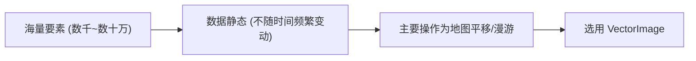
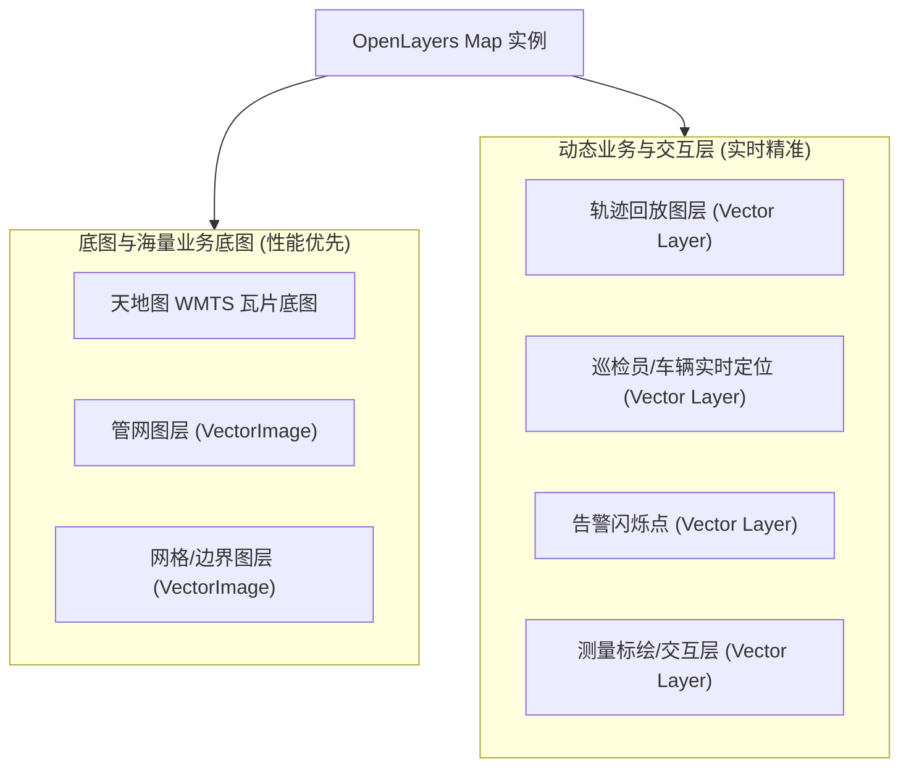

<nav aria-label="breadcrumb"><ol class="breadcrumb mb-4"><li class="breadcrumb-item"><a href="../">Home</a></li><li class="breadcrumb-item"><a href="./">Summary</a></li><li class="breadcrumb-item active" aria-current="page">Vector 与 VectorImage 选型指南</li></ol></nav>

# OpenLayers 图层选型指南：Vector 与 VectorImage 深度解析

在 WebGIS 开发（特别是管网大屏、轨迹监控、巡检业务）中，合理选择图层类型是保障地图渲染流畅度与消除显示异常的关键。本文系统总结 `ol/layer/Vector` 与 `ol/layer/VectorImage` 的底层渲染原理、性能差异、典型场景及架构最佳实践。

---

## 1. 核心底层渲染机制对比

| 维度 | `ol/layer/Vector`（实时矢量图层） | `ol/layer/VectorImage`（离屏栅格快照图层） |
| :--- | :--- | :--- |
| **渲染机制** | **实时逐帧矢量重绘**<br>每帧（约 16ms / 60fps）直接通过 HTML5 Canvas 2D 上下文遍历当前视口要素，调用 `beginPath()`、`lineTo()`、`stroke()`、`fill()` 等实时重绘。 | **离屏栅格化快照（Offscreen Snapshot）**<br>在后台离屏 Canvas 中将矢量要素烘焙为一张“静态图片”，地图渲染时直接通过 `drawImage()` 贴图。 |
| **平移漫游（Pan）** | 每一帧都重新实时计算几何坐标并绘制，要素多时（数万顶点）严重占用主线程，易造成**掉帧和拖拽卡顿**。 | 直接移动已生成的离屏图片，与普通切片底图一样轻量，**平移极度丝滑**。 |
| **缩放动画（Zoom）** | 每一帧重新计算像素坐标，**绝对锐利清晰、无锯齿变形**。 | 缩放过程中对上一帧静态图片应用 CSS / Canvas 矩阵拉伸，待缩放停止后才重绘生成新快照，**缩放瞬间有轻微像素拉伸感**。 |
| **动态更新与要素追加** | 要素增删改（`addFeature` / `setGeometry`）或坐标变化，下一帧立即精准响应，**完美适配动画与高频数据流**。 | 高频修改数据源会导致离屏 Canvas 频繁销毁重建；若与地图拖拽交互并发，易产生**图像拉伸撕裂、残影与颜色拖影**。 |
| **性能瓶颈** | **几何复杂度与要素数量**<br>（受顶点数、线段数影响严重） | **视口尺寸与离屏 Canvas 分辨率**<br>（对要素数量不敏感，但超大分辨率会有内存开销） |

---

## 2. 为什么项目渲染大量管网时 VectorImage 表现优异？

在地下管网（燃气、供水、排水、供热等）场景中：
1. **数据体量庞大**：一个城区或工业园区的管线往往包含数万至数十万个拐点和折线段；
2. **数据具静态特征**：管网数据载入地图后，走向、管径、拓扑关系固定，不会每秒频繁变动；
3. **主要操作以平移漫游为主**：用户主要在地图上平移查看各个路段与管段分布。

> - 若使用 `Vector`：每次鼠标微小拖动，浏览器必须在 16ms 限制内遍历数万个顶点进行数学投影转换并触发底层绘制，主线程被撑满，引起地图拖拽卡顿；
> - 若使用 `VectorImage`：管网载入后已预先烘焙在离屏图片中，拖拽地图时仅需执行一次 `ctx.drawImage(img, dx, dy, ...)`，性能消耗与要素数量无关，因此**万级管线平移依然流畅如丝**。

---

## 3. 适用场景划分标准

### 3.1 强烈推荐使用 `VectorImage` 的场景（“海量 + 静态”）



* **城市级管线管网系统**：燃气中低压管线、供排水管网、供热管网、通信光缆；
* **复杂交通网络**：道路中线、路网拓扑、铁路轨道线；
* **大范围面状区划**：行政边界、供气片区边界、网格化巡检单元、地籍地块面；
* **密集背景要素点**：阀门井、调压箱、防腐测试桩等万级静态打点。

**优化配置建议**：
实例化 `VectorImage` 时可调优 `imageRatio` 参数（默认通常为 1.15~1.5）：
```javascript
import VectorImageLayer from 'ol/layer/VectorImage';

const pipeLayer = new VectorImageLayer({
  source: pipeSource,
  imageRatio: 1.5, // 离屏画布扩展比率，增大可减少快速拖拽时的边缘留白
  renderBuffer: 200,
});
```

---

### 3.2 必须使用标准 `Vector` 的场景（“动态 + 交互 + 小体量”）


* **轨迹回放与 GPS 实时监控**：
  * 巡检人员、电瓶车、小黄车轨迹回放组件（如 `Playback.vue`）；
  * 定时器高频触发 `addFeature`、`setGeometry` 绘制线段与移动图标。
* **交互编辑与标绘图层**：
  * 鼠标测距、测面工具；
  * 管网绘制、标注添加、要素顶点拖拽（`ol/interaction/Modify`、`Draw`）；
  * 鼠标悬浮高亮（Hover Highlight）。
* **告警与动画特效**：
  * 压力超标报警闪烁点、水流动态箭头、粒子流向。
* **业务详情弹窗局域展示**：
  * 弹窗内仅展示单条巡检轨迹或周边数十个隐患点时，`Vector` 耗时 < 1ms，能提供最纯净、无失真的矢量表现。

---

## 4. WebGIS 项目架构最佳实践：“动静分层”

为兼顾海量数据的承载力与动态业务的零延迟、零残影，推荐在系统设计时贯彻**动静分层管理**模式：



### 总结口诀
- **管线面网体量大，离屏快照用 `VectorImage`；**
- **轨迹动画高频动，实时绘制选 `Vector`。**

---

## 5. 关联官方示例参考

* [`image-vector-layer`](../en/latest/examples/image-vector-layer.html) - `ol/layer/VectorImage` 离屏图片预渲染视口要素示例
* [`dynamic-data`](../en/latest/examples/dynamic-data.html) - `postrender` 动态数据流与矢量动画实时渲染
* [`draw-and-modify-features`](../en/latest/examples/draw-and-modify-features.html) - 矢量要素交互式绘制与顶点动态修改

