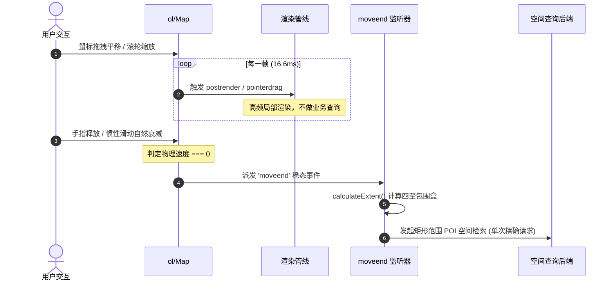
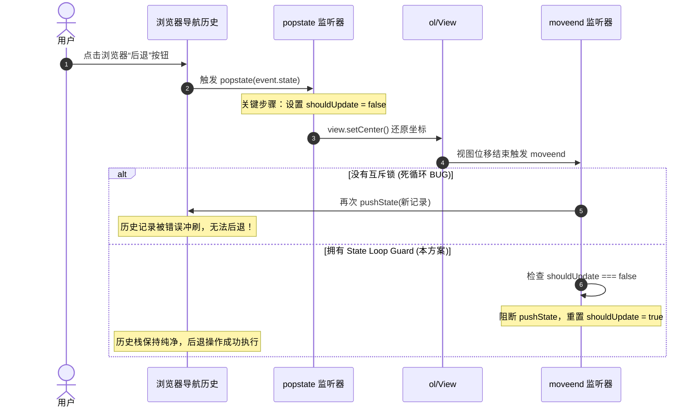
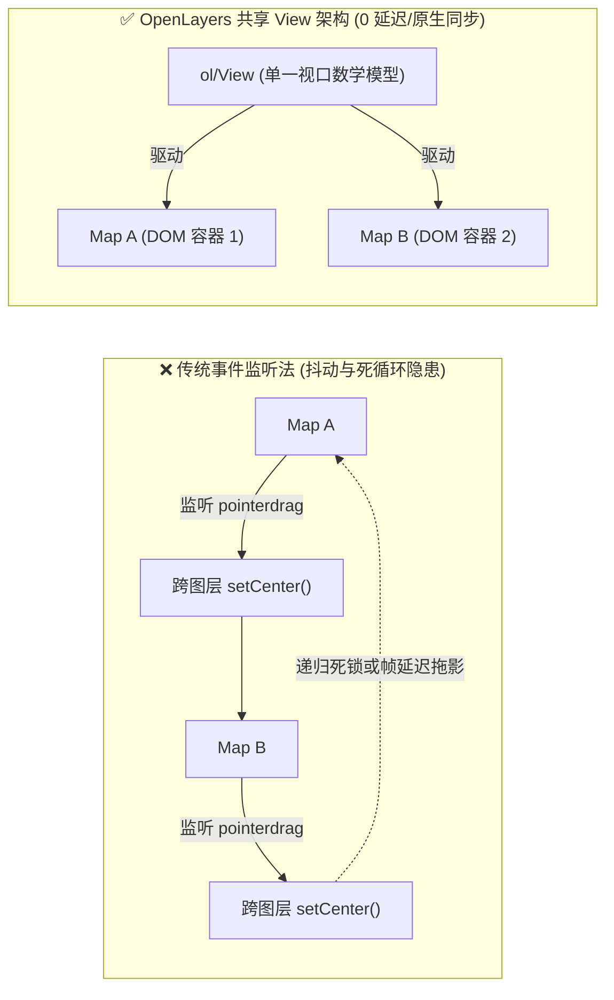

# OpenLayers 视图同步、永久链接历史栈与 moveend 事件生命周期实战架构指南

> 在现代 WebGIS 与地理空间中台应用中，地图不是一个孤立的静态视口，而是与用户操作轨迹、浏览器导航历史以及外部多屏看板深度互动的动态系统：
> 1. **生命周期终态监控（moveend）**：如何在平移、缩放、惯性减速完全停止后，高精度提取当前视口的地理包围盒，并优雅解决跨越日界线经度溢出问题？
> 2. **浏览器历史栈与永久链接（Permalink）**：如何将地图视口参数（Zoom/Center/Rotation）无缝序列化到 URL Hash 中，既支持随时一键分享视角，又能与浏览器的“前进/后退”按钮完美联动且不发生状态死循环？
> 3. **共享视图多屏零延迟联动（Shared Views）**：如何通过底层 View 与 Map 的解耦，让多个不同的地图容器（如路网底图 vs 遥感影像）实现 60FPS 的原生绝对同步，彻底告别传统监听事件带来的延迟抖动与递归死锁？
>
> 本文基于 3 个核心官方示例（`moveend.html`、`permalink.html`、`side-by-side.html`），系统解构 OpenLayers 在视图生命周期、历史状态同步以及多屏协同渲染层面的底层原理与工程设计模式。

---

## 1. 架构总览：视图（View）与地图（Map）的解耦协同拓扑

在 OpenLayers 的对象模型中，`ol/Map` 负责 DOM 事件捕获、图层管线合成与视口画布渲染；而 `ol/View` 则是纯粹的二维地理视口数学模型（管理投影坐标系、分辨率、中心点与旋转状态）。

```mermaid
graph TD
    subgraph Browser["浏览器宿主环境"]
        URL["URL Hash (#map=zoom/x/y/rot)"]
        History["HTML5 History API (pushState / popstate)"]
    end

    subgraph CoreModel["核心视口模型 (ol/View)"]
        ViewState["状态机: center, zoom, rotation, projection"]
        CalcExtent["calculateExtent(size) -> 空间包围盒"]
    end

    subgraph MapInstances["地图渲染宿主 (ol/Map)"]
        Map1["Map 1 (道路路网容器)<br/>target: 'roadMap'"]
        Map2["Map 2 (卫星航拍容器)<br/>target: 'aerialMap'"]
    end

    subgraph Lifecycle["事件生命周期"]
        MoveEndEvent["'moveend' 事件<br/>(用户拖拽/滚轮/惯性动画完全停止)"]
    end

    ViewState -->|共享同一个 View 实例| Map1
    ViewState -->|共享同一个 View 实例| Map2
    Map1 -->|交互结束| MoveEndEvent
    Map2 -->|交互结束| MoveEndEvent
    MoveEndEvent -->|计算 Extent + wrapLon| ExtentInputs["四至坐标表单 (WGS84)"]
    MoveEndEvent -->|状态序列化 (State Loop Guard 保护)| History
    History -->|状态还原| URL
    History -.->|popstate (前进/后退)| ViewState
```

### 1.1 三大核心机制对比分析

| 机制 / 维度 | 漫游终态事件 (`moveend`) | 永久链接历史栈 (`permalink`) | 共享视图多屏联动 (`side-by-side`) |
| :--- | :--- | :--- | :--- |
| **典型示例** | `moveend.html` | `permalink.html` | `side-by-side.html` |
| **核心 API** | `map.on('moveend')`, `calculateExtent` | `pushState`, `popstate`, Hash 编码 | `new Map({ view: sharedView })` |
| **触发时机** | 手势释放、滚轮结束、惯性动画彻底停止 | 视口终态改变且非 `popstate` 驱动时 | 任意屏幕发生拖拽/缩放时即时同步 |
| **同步延迟** | 防抖终态（完全静止后 1 次） | 终态写入（URL 不卡顿 60FPS 渲染） | 原生 0 毫秒（同帧 requestAnimationFrame） |
| **防御重点** | 经度累加溢出折叠（`wrapLon`） | 状态回环死循环（`shouldUpdate` 互斥锁） | 多图层 `maxZoom` 差异与白屏过缩放 |
| **适用业务** | 空间 POI 聚合查询、范围统计 | 空间书签、协同协作、分享回溯 | 遥感影像对比、历史时相变迁、多专题同屏 |

---

## 2. 漫游终态事件与视口空间四至计算（`moveend.html`）

### 2.1 为什么必须依赖 `moveend` 而非高频渲染事件？

在前端地图开发中，常见以下事件：
- `pointerdrag`：鼠标拖拽时每秒触发数十次；
- `postrender`：图层渲染完成，60FPS 高频触发；
- `change:center` / `change:resolution`：属性变动即刻派发。

如果在上述高频事件中发起空间拓扑分析或调用后端空间查询接口，浏览器主线程将发生严重丢帧，后端接口也会瞬间被并发打满。
`moveend` 是 OpenLayers 官方设计的**天然稳态节流事件**：它在用户手指抬起、鼠标滚轮滚动停止、且双击或平移动画的物理惯性（Deceleration kinetic）彻底减速为 0 后才会派发。



### 2.2 视口几何外包盒提取与跨日界线经度折叠

通过 `map.getView().calculateExtent(map.getSize())` 可以获得当前投影平面（如 EPSG:3857）下的 `[minX, minY, maxX, maxY]` 包围盒，再经由 `toLonLat()` 转换为 WGS84 经纬度。

但当用户横向连续拖拽地图跨越多圈地球时，投影坐标下的经度会呈现 $+540^\circ, +900^\circ$ 等超范围累加。示例中设计的 `wrapLon` 算法利用周期向下取整，将其严格折叠回归至 $[-180^\circ, +180^\circ]$ 标准地理区间：

```javascript
// 跨反子午线经度规整算法
function wrapLon(value) {
  // 计算当前经度跨越了几个完整的 360 度世界周期
  const worlds = Math.floor((value + 180) / 360);
  return value - worlds * 360;
}

function onMoveEnd(evt) {
  const map = evt.map;
  // 提取视口几何外包矩形并转换为经纬度对角点
  const extent = map.getView().calculateExtent(map.getSize());
  const bottomLeft = toLonLat(getBottomLeft(extent));
  const topRight = toLonLat(getTopRight(extent));

  display('left', wrapLon(bottomLeft[0]));
  display('bottom', bottomLeft[1]);
  display('right', wrapLon(topRight[0]));
  display('top', topRight[1]);
}

map.on('moveend', onMoveEnd);
```

---

## 3. 永久链接与浏览器历史栈双向同步（`permalink.html`）

### 3.1 状态序列化与 URL 编码

永久链接（Permalink）允许用户将当前视口的核心三要素：`zoom`、`center`、`rotation` 固化在 URL 中，实现“所见即所得”的协作分享。

示例采用 Hash 结构：`#map=zoom/center_x/center_y/rotation`。
在页面初始化时，优先解析该 Hash 参数构建 View；若为空则平滑回退至默认配置：

```javascript
let zoom = 2;
let center = [0, 0];
let rotation = 0;

if (window.location.hash !== '') {
  // 从 Hash 中反序列化视图三要素
  const hash = window.location.hash.replace('#map=', '');
  const parts = hash.split('/');
  if (parts.length === 4) {
    zoom = parseFloat(parts[0]);
    center = [parseFloat(parts[1]), parseFloat(parts[2])];
    rotation = parseFloat(parts[3]);
  }
}

const map = new Map({
  target: 'map',
  view: new View({ center, zoom, rotation }),
});
```

### 3.2 状态回环死循环（State Loop）与互斥锁防御

双向状态同步中最危险的缺陷就是**事件无限回环**：
1. 用户在浏览器中点击“后退”按钮；
2. 触发 `window.addEventListener('popstate')`；
3. 代码从历史快照中恢复坐标，调用 `view.setCenter(...)`；
4. 视图移动停止后，触发 `map.on('moveend')`；
5. 若 `moveend` 继续调用 `history.pushState()`，则刚才的后退操作被再次冲掉，形成死锁！



关键工程实现如下：

```javascript
let shouldUpdate = true;
const view = map.getView();

const updatePermalink = function () {
  if (!shouldUpdate) {
    // 当视图是由 popstate 监听器驱动更新时，不向历史栈重复写入，重置标志位后退出
    shouldUpdate = true;
    return;
  }

  const center = view.getCenter();
  const hash =
    '#map=' +
    view.getZoom().toFixed(2) +
    '/' +
    center[0].toFixed(2) +
    '/' +
    center[1].toFixed(2) +
    '/' +
    view.getRotation();
  const state = {
    zoom: view.getZoom(),
    center: view.getCenter(),
    rotation: view.getRotation(),
  };
  window.history.pushState(state, 'map', hash);
};

map.on('moveend', updatePermalink);

// 监听浏览器前进/后退
window.addEventListener('popstate', function (event) {
  if (event.state === null) {
    return;
  }
  map.getView().setCenter(event.state.center);
  map.getView().setZoom(event.state.zoom);
  map.getView().setRotation(event.state.rotation);
  // 将互斥锁置为 false，阻断随后的 moveend 事件再次向历史栈灌入重复记录
  shouldUpdate = false;
});
```

---

## 4. 共享视图与多屏无缝联动（`side-by-side.html`）

### 4.1 传统事件监听法 vs 共享视图模式

在多屏分屏对比（如遥感影像与规划矢量底图分屏）中，有两种实现机制：



在共享 View 模式下：
- **零胶水代码**：无需编写任何事件监听器与递归拦截逻辑；
- **零渲染延迟**：两个 Map 内部的图层渲染器在同一个事件循环周期内接收 View 的改变通知，由浏览器的 `requestAnimationFrame` 同步重绘，保证了 60FPS 的丝滑顺畅。

```javascript
// 创建单一全局共享 View
const view = new View({
  center: [-6655.54, 6709968.25],
  zoom: 13,
});

// 第一个地图实例（道路路网）
const map1 = new Map({
  target: 'roadMap',
  layers: [roadLayer],
  view: view, // 绑定共享 view
});

// 第二个地图实例（遥感影像）
const map2 = new Map({
  target: 'aerialMap',
  layers: [aerialLayer],
  view: view, // 绑定同一个 view
});
```

---

## 5. 生产实践踩坑与企业级优化指南

### 5.1 `pushState` vs `replaceState` 的交互体验调优

在默认的 `permalink` 实现中，用户每拖动一次地图都会向浏览历史栈推入一条新记录。如果用户在一个页面漫游了 20 次，他需要连续狂点 20 次浏览器的“后退”按钮才能退出该网站，这在生产环境中会带来极差的用户体验。

**企业级最佳实践**：
- **微小平移与缩放**：采用 `history.replaceState()` 仅静默替换当前 Hash，不新增历史记录；
- **关键视口切换 / 检索定位**：当用户通过搜索栏点击某个特定 POI，或者点击“缩放到城市级别”等业务动作时，才显式调用 `history.pushState()`；
- **时间防抖（Debounce）**：设置 1~2 秒的防抖定时器，用户连续平移过程中只替换，停止操作 2 秒后才 push 一次。

### 5.2 旋转（Rotation &ne; 0）时的外包盒膨胀陷阱

调用 `map.getView().calculateExtent(map.getSize())` 时必须牢记：**它返回的是轴对齐外包矩形（Axis-Aligned Bounding Box, AABB）**。
如果用户通过 Alt + Shift 拖拽将地图旋转了 45 度，屏幕视口在地理空间上呈现为一个菱形，而 `calculateExtent()` 返回的矩形将包围整个菱形，其覆盖面积比屏幕实际可见区域扩大了近一倍！
向服务端请求矢量数据或切片时，若直接使用该 Extent 作为 BBOX，可能会多拉取大量屏幕外的冗余数据。解决方案是在服务端支持 Polygon 多边形范围查询，并在前端通过计算视口四个角点的精确空间坐标作为相交多边形。

### 5.3 跨图层最大分辨率（maxZoom）不一致导致的分屏白屏

在分屏对比场景下，城市道路切片往往能支持到 22 级，而遥感卫星切片服务通常仅提供到 18~20 级。
当用户持续放大至 21 级时，卫星分屏可能因请求 404 瓦片而大面积白屏。
**解决策略**：
1. 为卫星图层源配置 `interpolate: true` 与切片过度缩放（Oversampling），允许缺失高等级瓦片时自动拉伸放大低等级切片；
2. 或者在共享 View 上配置 `constrainResolution: true` 与 `maxZoom: 20` 统一兜底。
