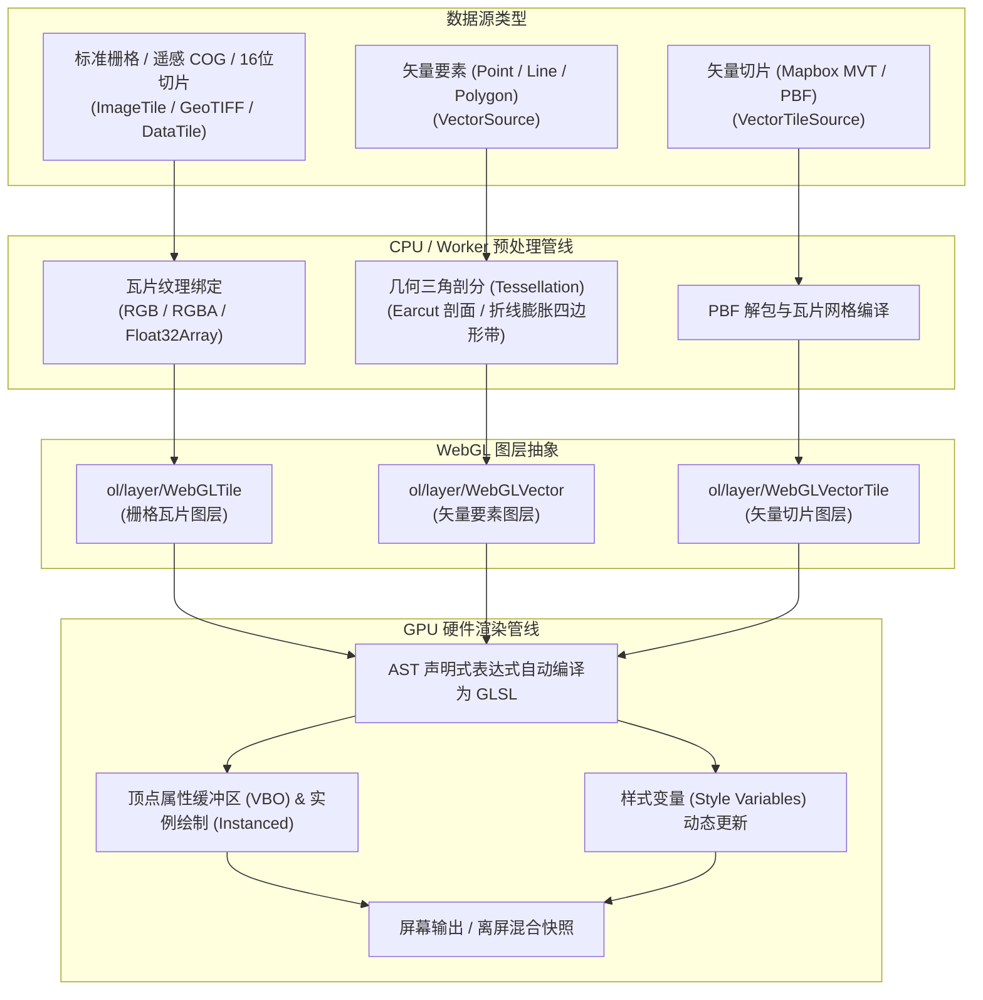

<nav aria-label="breadcrumb"><ol class="breadcrumb mb-4"><li class="breadcrumb-item"><a href="../">Home</a></li><li class="breadcrumb-item"><a href="./">Summary</a></li><li class="breadcrumb-item active" aria-current="page">WebGL 渲染架构指南</li></ol></nav>

# OpenLayers WebGL 渲染引擎与着色器实战架构指南
> 基于 19 个官方核心 WebGL 示例，深度解构 GPU 硬件加速管线、表达式语法树（AST）、波段代数与海量空间数据实战

---

## 引言：为什么 WebGIS 需要 WebGL 渲染引擎

在传统的 WebGIS 渲染架构中，地图视图主要依赖浏览器的 HTML5 Canvas 2D 上下文。当面临以下现代复杂业务场景时，Canvas 2D 往往会遇到性能瓶颈：
1. **海量矢量要素渲染**：屏幕存在数万至数十万个点位或密集路网时，CPU 端逐要素遍历并执行绘图指令（`arc`、`lineTo`）会引发主线程阻塞，导致帧率断崖式下跌；
2. **多波段遥感与科学栅格分析**：云原生 GeoTIFF（COG）、16 位高动态深度的数字高程（DEM）或气象多维网格（Zarr/NetCDF），若在 CPU 端逐像素计算植被指数（NDVI）或坡度坡向，处理延迟通常以秒计；
3. **时序动态模拟与毫秒级高频交互**：在气象雷达回波、航班动态轨迹或海平面上升淹没模拟中，滑块每拖动一次都需要即时响应，重新切图或遍历样式开销巨大。

OpenLayers 从底层重构并推出了现代化的 **WebGL 渲染体系**（包括 `WebGLTile`、`WebGLVector`、`WebGLVectorTile` 与 `Heatmap`）。它将运算从 CPU 转移到 GPU 显卡硬件，通过高度优化的着色器表达式（Expression AST）提供实时栅格化与计算能力。

本文基于官方示例库中精选的 **19 个 WebGL 核心示例**，系统梳理 OpenLayers WebGL 的技术架构、表达式设计模型与生产落地实践。

---

## 第一部分：全景视盘——19 个核心 WebGL 示例矩阵

下表将 19 个官方示例按图层体系与应用场景进行了全景梳理：

| 技术分类 | 示例标识 | 核心类 / 关键 API | 解决的典型生产场景 |
| :--- | :--- | :--- | :--- |
| **栅格瓦片与遥感增强** | [`webgl-tiles`](../en/latest/examples/webgl-tiles.html) | `ol/layer/WebGLTile` + `ImageTile` | 基础栅格瓦片 GPU 硬件加速加载，跳过 2D Canvas 重绘开销 |
| | [`webgl-tile-style`](../en/latest/examples/webgl-tile-style.html) | `WebGLTile({style: {exposure, contrast...}})` | 瓦片实时色彩调整：动态控制曝光度、对比度与饱和度 |
| | [`webgl-layer-swipe`](../en/latest/examples/webgl-layer-swipe.html) | `prerender` + `gl.scissor()` | 硬件级视口剪裁：利用显卡 Scissor 测试实现零开销图层卷帘对比 |
| | [`wms-time-webgl`](../en/latest/examples/wms-time-webgl.html) | `WebGLTile` + `TileWMS.updateParams()` | 双缓冲时序重载：WMS 连续切换时间帧无白屏闪烁平滑过渡 |
| **波段代数与地形计算** | [`webgl-sea-level`](../en/latest/examples/webgl-sea-level.html) | `['band', n]` + Terrain-RGB 解码 | 片元着色器实时计算高程：模拟不同海平面上升高度下的淹没区域 |
| | [`webgl-shaded-relief`](../en/latest/examples/webgl-shaded-relief.html) | `['band', n, dx, dy]` 邻域采样 | 坡度坡向实时解算：根据太阳高度角与方位角动态生成山体日照晕渲 |
| | [`numpytile`](../en/latest/examples/numpytile.html) | `ol/source/DataTile` + 16 位数组解析 | 科学数据直读：解析 16 位高动态 NumPy 遥感瓦片并进行动态对比度拉伸 |
| | [`cog-style`](../en/latest/examples/cog-style.html) | COG + 波段代数归一化 | 多波段遥感 NDVI 植被指数动态计算与伪彩色图层渐变映射 |
| | [`cog-stretch`](../en/latest/examples/cog-stretch.html) | COG + 动态变量百分比截断 | 卫星遥感原始反射率动态直方图对比度增强显示 |
| | [`multiple-cogs`](../en/latest/examples/multiple-cogs.html) | `WebGLTile({sources: [...]})` 跨 UTM 分带 | 跨分带 COG 边缘多源拼接、实时重投影与 RGB 通道动态重构 |
| **海量矢量点位与精灵图** | [`filter-points-webgl`](../en/latest/examples/filter-points-webgl.html) | `WebGLVectorLayer` + `['time']` 动画 | 4.5 万个陨石撞击点流畅渲染、着色器内置时钟驱动呼吸脉冲与时间过滤 |
| | [`icon-sprite-webgl`](../en/latest/examples/icon-sprite-webgl.html) | 纹理图集（Sprite Atlas） + `icon-offset` | 8 万个 UFO 目击事件渲染，单张大图纹理子域采样规避 Draw Call 瓶颈 |
| | [`webgl-points-layer`](../en/latest/examples/webgl-points-layer.html) | 声明式样式编辑器 + 复杂符号化 | 预设三角形、动态旋转柱状图、随层级保持物理尺寸的圆与文本标注 |
| **折线、面要素与矢量切片** | [`webgl-vector-layer`](../en/latest/examples/webgl-vector-layer.html) | 多边形面三角剖分（Earcut） + 条件高亮 | 复杂生态区面要素渲染，基于 `updateStyleVariables` 瞬间切换悬停高亮 |
| | [`webgl-draw-line`](../en/latest/examples/webgl-draw-line.html) | 线段膨胀三角带 + `stroke-line-dash` | 线端线帽（Cap）、拐角斜接（Join）与 GPU 过程式虚线生成 |
| | [`filter-webgl-line`](../en/latest/examples/filter-webgl-line.html) | `XYM` 坐标布局 + `['line-metric']` | 高维时序飞行轨迹沿线插值渐变与时间阈值动态截断 |
| | [`webgl-vector-tiles`](../en/latest/examples/webgl-vector-tiles.html) | `ol/layer/WebGLVectorTile` + MVT 瓦片 | 城市级全量矢量切片（路网、水体、建筑）GPU 硬件加速高速渲染 |
| **热力场与核密度分析** | [`heatmap-earthquakes`](../en/latest/examples/heatmap-earthquakes.html) | `ol/layer/Heatmap` (点要素) | 地震点位震级权重叠加、WebGL 离屏高斯模糊与调色板着色 |
| | [`heatmap-trajectories`](../en/latest/examples/heatmap-trajectories.html) | `ol/layer/Heatmap` (线要素) | 船舶航迹线要素密度叠加、核半径动态调优与船种实时过滤 |

---

## 第二部分：架构全景——OpenLayers WebGL 渲染管线模型

OpenLayers 将不同数据类型抽象为三大核心 WebGL 图层类，并在底层统一了着色器生成与显存管理机制：



### 核心设计原则
1. **CPU 与 GPU 的明确分工**：
   - **CPU / Web Worker**：负责 I/O 读取、数据解压与几何拓扑三角剖分（如面要素由 Earcut 生成三角形索引）；
   - **GPU 显存**：要素顶点坐标与属性（如质量、时间戳、年份）作为顶点属性（Attribute）常驻显存。
2. **表达式即着色器（Expressions as Shaders）**：
   开发者书写的并不是纯 GLSL 字符串，而是符合规范的 JSON 抽象语法树（AST）。OpenLayers 的着色器编译器在图层初始化时自动将其编译成高性能 GLSL 代码。

---

## 第三部分：核心引擎——声明式样式表达式（Expression AST）

WebGL 渲染体系彻底告别了传统 `styleFunction(feature, resolution)` 逐要素回调的模式，采用声明式数组语法树。

### 1. 基础语法骨架与操作符分类

表达式通常以数组形式组织：`[operator, ...operands]`。

| 操作符类别 | 典型语法 | 运行机制与用途 |
| :--- | :--- | :--- |
| **属性读取** | `['get', 'population']` | 从要素属性中提取字段值，映射为 GPU 顶点属性 |
| | `['id']` | 读取要素的唯一 ID 标识 |
| **动态变量** | `['var', 'minYear']` | 映射为着色器中的 Uniform 变量，通过 `updateStyleVariables` 更新 |
| **数学运算** | `['+', a, b]`, `['*', a, b]`, `['^', a, 2]` | GPU 级并行算术计算（加减乘除、求幂、模运算 `%`） |
| | `['atan', y, x]`, `['sqrt', x]`, `['clamp', v, min, max]` | 三角函数与数值截断约束 |
| **插值映射** | `['interpolate', ['linear'], input, x1, y1, x2, y2...]` | 线性分段连续插值（如数值映射颜色、高程映射半径） |
| | `['interpolate', ['exponential', 2], ['zoom'], ...]` | 底数为 2 的指数插值，常用于保持世界物理尺寸不变 |
| **逻辑分支** | `['case', condition1, output1, defaultOutput]` | 三元条件分支判定 |
| | `['match', input, key1, val1, key2, val2..., defaultVal]` | 多分支模式匹配（如按 UFO 形状取偏移量） |
| | `['between', val, min, max]`, `['any', ...]`, `['all', ...]` | 逻辑区间与布尔组合判定 |
| **着色器内置信号**| `['time']` | 递增动画时钟（秒），驱动自旋转与脉冲光晕 |
| | `['zoom']` | 当前视口缩放层级（支持浮点插值） |
| | `['resolution']` | 当前地图物理分辨率（米/像素） |
| | `['line-metric']` | 仅在 `XYM` 折线中可用，GPU 自动内插的沿线度量值 |
| **栅格波段运算** | `['band', 1]` | 提取当前像素指定波段的归一化强度值（$0 \sim 1$） |
| | `['band', 1, -1, 0]` | **邻域采样**：提取当前像元偏移 `[-1, 0]` 的邻域像素值 |

---

## 第四部分：经典实战案例解构

### 案例 1：Terrain-RGB 高程解算与海平面淹没模拟（`webgl-sea-level`）

MapTiler / Mapbox 的 Terrain-RGB 瓦片通过 24 位 RGB 存储真实高程：
$$Elevation = -10000 + (R \times 256 \times 256 + G \times 256 + B) \times 0.1$$

由于 OpenLayers 的 `['band', n]` 取得的是归一化到 $[0, 1]$ 的浮点数，因此在着色器中需要乘以 255 还原字节数值：

```javascript
// 高程反算着色器表达式
const elevation = [
  '+',
  -10000,
  ['*', 0.1 * 255 * 256 * 256, ['band', 1]], // R 通道权重 1671168
  ['*', 0.1 * 255 * 256, ['band', 2]],       // G 通道权重 6528
  ['*', 0.1 * 255, ['band', 3]],             // B 通道权重 25.5
];

// 图层配置
const seaLevelLayer = new WebGLTileLayer({
  source: terrainRgbSource,
  style: {
    variables: { level: 0 },
    color: [
      'case',
      ['<=', elevation, ['var', 'level']],
      [139, 212, 255, 1], // 低于海平面：着水蓝色
      [139, 212, 255, 0], // 高于海平面：完全透明
    ],
  },
});
```

### 案例 2：利用邻域采样实时生成山体日照晕渲（`webgl-shaded-relief`）

传统山体阴影需要离线预切，而在 WebGL 中，利用 `['band', bandIdx, dx, dy]` 可直接在片元着色器中计算 3x3 邻域中心差分：

```javascript
// 提取偏移位置的高程
function elevation(dx, dy) {
  return [
    '+',
    ['*', 255 * 256, ['band', 1, dx, dy]],
    ['*', 255, ['band', 2, dx, dy]],
    ['*', 255 / 256, ['band', 3, dx, dy]],
    -32768,
  ];
}

// 中心差分梯度
const dp = ['*', 2, ['resolution']];
const dzdx = ['/', ['-', ['*', ['var', 'vert'], elevation(1, 0)], ['*', ['var', 'vert'], elevation(-1, 0)]], dp];
const dzdy = ['/', ['-', ['*', ['var', 'vert'], elevation(0, 1)], ['*', ['var', 'vert'], elevation(0, -1)]], dp];

// 坡度与坡向
const slope = ['atan', ['sqrt', ['+', ['^', dzdx, 2], ['^', dzdy, 2]]]];
const aspect = ['clamp', ['atan', ['-', 0, dzdx], dzdy], -Math.PI, Math.PI];

// 漫反射光照入射角余弦值
const cosIncidence = [
  '+',
  ['*', ['sin', ['var', 'sunEl']], ['cos', slope]],
  ['*', ['cos', ['var', 'sunEl']], ['sin', slope], ['cos', ['-', ['var', 'sunAz'], aspect]]],
];
```

### 案例 3：8 万点精灵图集（Sprite Atlas）与色彩插值（`icon-sprite-webgl`）

将各种外形图标打包在同一张贴图网格中，通过 `match` 动态指定 UV 纹理偏移：

```javascript
const style = {
  'icon-src': 'data/ufo_shapes.png',
  'icon-width': 128,
  'icon-height': 64,
  'icon-size': [32, 32],
  // 根据目击年份在着色器中插值着色
  'icon-color': [
    'interpolate', ['linear'], ['get', 'year'],
    1950, [255, 160, 110], // 早期偏红
    2013, [180, 255, 200], // 近期偏蓝绿
  ],
  // 纹理子域采样偏移
  'icon-offset': [
    'match', ['get', 'shape'],
    'light', [0, 0],
    'sphere', [32, 0],
    'disc', [64, 0],
    'fireball', [0, 32],
    [96, 32] // 默认回退偏移
  ],
};
```

---

## 第五部分：生产环境工程最佳实践与避坑清单

1. **`updateStyleVariables()` vs 图层重建**：
   - **极速路径**：改变颜色、阈值、时间戳、高亮 ID 等数值时，**务必使用 `layer.updateStyleVariables(variables)`**。这仅修改 GPU Uniform 标量，耗时 $< 0.1 \text{ms}$；
   - **重编译路径**：只有当增删操作符结构、切换纹理图片路径或修改着色器控制流时，才需要调用 `layer.setStyle()` 或重建图层。
2. **海量点要素关闭拾取探测（Hit Detection）**：
   在渲染 5 万个以上点要素时，如果不依赖鼠标点击或悬停拾取，显式配置 `disableHitDetection: true`。这可以彻底跳过离屏拾取缓冲区的渲染开销，帧率提升可达 40% 以上。
3. **高分屏像素比与 Scissor 剪裁**：
   在利用 `gl.scissor` 制作卷帘（Swipe）对比时，务必通过 `getRenderPixel(event, cssPixel)` 获取真实的物理渲染像素，并考虑 WebGL 原点在左下角（Y 轴向上）的坐标系差异。
4. **共享 WebGL 上下文（Context Sharing）**：
   当一个页面存在多个 WebGL 图层时，为它们赋予相同的 `className: 'canvas3d'` 可以让 OpenLayers 复用同一个 WebGLRenderingContext，降低显存占用并减少移动端浏览器 WebGL 上下文丢失（Context Lost）的风险。

---

## 附录：19 个 WebGL 核心示例直达索引

1. [webgl-tiles (基础栅格瓦片 GPU 加速加载)](../en/latest/examples/webgl-tiles.html)
2. [webgl-tile-style (栅格瓦片实时色彩调整)](../en/latest/examples/webgl-tile-style.html)
3. [webgl-layer-swipe (硬件级视口剪裁图层卷帘)](../en/latest/examples/webgl-layer-swipe.html)
4. [wms-time-webgl (WMS 时序动态瓦片平滑过渡)](../en/latest/examples/wms-time-webgl.html)
5. [webgl-sea-level (DEM 高程解码与海平面上升模拟)](../en/latest/examples/webgl-sea-level.html)
6. [webgl-shaded-relief (邻域像元采样与动态山体日照晕渲)](../en/latest/examples/webgl-shaded-relief.html)
7. [numpytile (16位科学栅格瓦片直读与对比度拉伸)](../en/latest/examples/numpytile.html)
8. [cog-style (卫星影像多波段植被指数计算与渐变映射)](../en/latest/examples/cog-style.html)
9. [cog-stretch (原始反射率动态直方图拉伸)](../en/latest/examples/cog-stretch.html)
10. [multiple-cogs (跨分带 COG 重投影与通道动态重构)](../en/latest/examples/multiple-cogs.html)
11. [filter-points-webgl (海量点位过滤与着色器脉冲动画)](../en/latest/examples/filter-points-webgl.html)
12. [icon-sprite-webgl (纹理图集 UV 子域采样海量点渲染)](../en/latest/examples/icon-sprite-webgl.html)
13. [webgl-points-layer (点要素声明式着色器样式编辑器)](../en/latest/examples/webgl-points-layer.html)
14. [webgl-vector-layer (多边形面三角剖分与悬停高亮)](../en/latest/examples/webgl-vector-layer.html)
15. [webgl-draw-line (线段三角带膨胀与过程式虚线)](../en/latest/examples/webgl-draw-line.html)
16. [filter-webgl-line (XYM 时序轨迹沿线渐变与时间截断)](../en/latest/examples/filter-webgl-line.html)
17. [webgl-vector-tiles (城市级 MVT 矢量切片硬件加速渲染)](../en/latest/examples/webgl-vector-tiles.html)
18. [heatmap-earthquakes (点要素 WebGL 核密度热力场)](../en/latest/examples/heatmap-earthquakes.html)
19. [heatmap-trajectories (折线航迹要素 WebGL 热力场)](../en/latest/examples/heatmap-trajectories.html)
