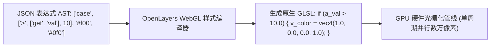

<nav aria-label="breadcrumb"><ol class="breadcrumb mb-4"><li class="breadcrumb-item"><a href="../">Home</a></li><li class="breadcrumb-item"><a href="./">Summary</a></li><li class="breadcrumb-item active" aria-current="page">WebGL 着色器与张量瓦片指南</li></ol></nav>

# OpenLayers WebGL 专用高级着色器与张量瓦片计算实战指南

> 面对海量地理大数据（数十万离散点位、复杂折线管网、多维浮点科学张量数据），传统的 Canvas 2D 渲染器受限于 CPU 单线程运算与频繁的主内存与显存数据交换，往往在万级图元时便出现卡顿。
>
> OpenLayers 拥有现代化的 WebGL 专用硬件加速渲染管线。其不仅提供了类似于 Mapbox GL 的**声明式样式表达式引擎（Style Expressions Engine）**，在底层自动将 JSON 表达式编译为高执行效率的 GLSL 顶点/片元着色器代码，还深度支持了 **GPU 纹理雪碧图（Sprite Sheet）批处理**，以及跨界的 **NumPy 原生多维张量瓦片直通渲染**。
>
> 本文基于 5 个核心官方示例，系统解构 OpenLayers WebGL 高级着色器编译机制、动态表达式过滤、GPU 批处理与科学计算张量瓦片实战。

---

## 1. 架构总览：5 个 WebGL 高级着色与张量瓦片核心示例矩阵

| 分类 | 示例标识 | 核心技术机制 | 解决的典型生产场景 |
| :--- | :--- | :--- | :--- |
| **WebGL 点要素着色过滤** | [`filter-points-webgl`](../en/latest/examples/filter-points-webgl.html) | `WebGLPointsLayer` + 声明式着色器条件过滤表达式 | 50,000+ 气象站点/地震点按震级与年份极速动态筛选 |
| **WebGL 线图层着色器** | [`filter-webgl-line`](../en/latest/examples/filter-webgl-line.html) | `WebGLVectorLayer` + 硬件法线外扩生成抗锯齿宽线 | 复杂电力传输线、交通路网车流量动态色彩与线宽绑定 |
| **GPU 图标雪碧图合批** | [`icon-sprite-webgl`](../en/latest/examples/icon-sprite-webgl.html) | 单张纹理图集（Texture Atlas）+ 纹理坐标 UV 偏移 | 单次 Draw Call 硬件极速渲染数十万不同类型的 POI 图标 |
| **NumPy 张量切片渲染** | [`numpytile`](../en/latest/examples/numpytile.html) | 原生 Float32 多维张量切片直读 + 片元着色器像素映射 | Python 科学计算（AI/气候模型）输出数据直接在前端显卡上解算 |
| **WebGL 矢量切片渲染** | [`webgl-vector-tiles`](../en/latest/examples/webgl-vector-tiles.html) | MVT 矢量瓦片硬件着色管线 | 移动端与高并发场景下极致丝滑的矢量切片地图浏览 |

---

## 2. 声明式样式表达式（Style Expressions）底层编译机理

OpenLayers 的 WebGL 样式并非由 CPU 逐个要素遍历计算，而是声明为 JSON 抽象语法树（AST），在图层初始化时由 OpenLayers 内部编译器将其直接**编译翻译为原生 GLSL 片元与顶点着色器代码**：



### 2.1 常用核心表达式语法表

| 表达式类型 | 语法结构示例 | 编译对应的 GLSL 逻辑 |
| :--- | :--- | :--- |
| **属性提取** | `['get', 'magnitude']` | 顶点属性输入 `attribute float a_magnitude;` |
| **变量引用** | `['var', 'minYear']` | Uniform 动态全局变量 `uniform float u_minYear;` |
| **条件分支** | `['case', condition, val1, val2]` | 三元运算符或条件分支 `condition ? val1 : val2` |
| **数值插值** | `['interpolate', ['linear'], ['get', 'depth'], 0, '#00f', 500, '#f00']` | 硬件线性混合函数 `mix(color0, color1, t)` |

---

## 3. WebGL 点图层动态过滤实战（`filter-points-webgl`）

```javascript
import WebGLPointsLayer from 'ol/layer/WebGLPoints.js';
import VectorSource from 'ol/source/Vector.js';
import GeoJSON from 'ol/format/GeoJSON.js';

const webglPoints = new WebGLPointsLayer({
  source: new VectorSource({
    url: 'data/world-earthquakes.geojson',
    format: new GeoJSON(),
  }),
  style: {
    // 动态全局变量（Uniforms），可以在运行时毫秒级更新而无需重新编译着色器
    variables: {
      minMagnitude: 4.0,
      targetYear: 2026,
    },
    // 过滤条件：仅渲染震级大于 minMagnitude 且年份匹配的点
    filter: [
      'all',
      ['>=', ['get', 'mag'], ['var', 'minMagnitude']],
      ['==', ['get', 'year'], ['var', 'targetYear']],
    ],
    symbol: {
      symbolType: 'circle',
      // 大小与震级成正比
      size: ['*', ['get', 'mag'], 4],
      // 深度越大，颜色越深
      color: [
        'interpolate',
        ['linear'],
        ['get', 'depth'],
        0, 'rgba(255, 255, 0, 0.8)',
        100, 'rgba(255, 0, 0, 0.8)',
      ],
    },
  },
});

// 滑块滑动时直接更新着色器变量，完全零 CPU 遍历重绘开销
slider.addEventListener('input', function (e) {
  webglPoints.updateStyleVariables({
    minMagnitude: parseFloat(e.target.value),
  });
});
```

---

## 4. GPU 纹理雪碧图批处理合批（`icon-sprite-webgl`）

如果要渲染 100,000 个具有不同类型图标（学校、医院、车站、餐饮）的 POI：
- 若使用传统 Canvas 2D 为每个点单独 `drawImage`，显存上下文切换将使帧率骤降到 5 FPS。
- WebGL 方案：将所有图标打包进单张超大**纹理图集（Sprite Atlas）**，为每个要素分配纹理坐标偏移量 $(U, V)$，通过单次 Draw Call 瞬时完成硬件绘制：

$$\text{UV}_{\text{coord}} = \left[\frac{x_{\text{sprite}} + u \cdot w_{\text{icon}}}{W_{\text{atlas}}}, \quad \frac{y_{\text{sprite}} + v \cdot h_{\text{icon}}}{H_{\text{atlas}}}\right]$$

```javascript
const spriteStyle = {
  symbol: {
    symbolType: 'image',
    src: 'assets/all-icons-sprite.png',
    // 利用属性中存储的雪碧图切片坐标
    offset: ['get', 'offset'],
    size: [32, 32],
  },
};
```

---

## 5. NumPy 科学计算张量切片直接渲染（`numpytile`）

在气象数值预报（ECMWF、GFS）或海洋模拟中，数据通常存储在 Python 的 NumPy 二维/三维浮点数数组中（如 `temperature.npy`）。

以往需要将其在后端转译为 PNG 图片再切片，带来精度损失。
OpenLayers 的 `NumpyTile` 模式允许浏览器通过 Fetch 直接获取 Float32 二进制字节流，包装为 WebGL 浮点纹理（Floating-Point Texture），直接由显卡执行物理量色阶映射：

```javascript
import DataTile from 'ol/source/DataTile.js';
import WebGLTileLayer from 'ol/layer/WebGLTile.js';

const numpyLayer = new WebGLTileLayer({
  source: new DataTile({
    loader: function (z, x, y) {
      return fetch(`data/tiles/${z}/${x}/${y}.npy`)
        .then((res) => res.arrayBuffer())
        .then((buffer) => {
          // 跳过 NumPy 128 字节头信息，直接构造 Float32Array 显存数据
          return new Float32Array(buffer, 128);
        });
    },
  }),
  style: {
    color: [
      'interpolate',
      ['linear'],
      ['band', 1],
      -20.0, [0, 0, 255, 1], // 零下20度渲染为深蓝
      0.0, [0, 255, 255, 1],  // 0度浅蓝
      35.0, [255, 0, 0, 1],   // 35度红色
    ],
  },
});
```
