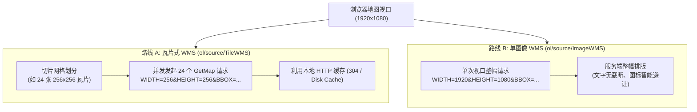
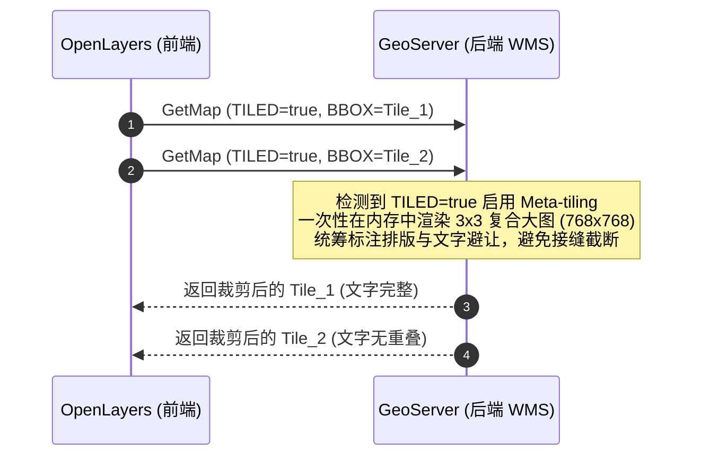

<nav aria-label="breadcrumb"><ol class="breadcrumb mb-4"><li class="breadcrumb-item"><a href="../">Home</a></li><li class="breadcrumb-item"><a href="./">Summary</a></li><li class="breadcrumb-item active" aria-current="page">WMS 动态地图服务架构指南</li></ol></nav>

# OpenLayers WMS 动态地图服务全景实战架构指南
> 基于 14 个官方核心 WMS 示例，深度解构 TileWMS 与 ImageWMS 双管线、元瓦片（Meta-tiling）避让、时序雷达双缓冲、高分屏（HiDPI）适配与客户端动态重投影

---

## 引言：为什么企业级 WebGIS 依然离不开 WMS？

在当前静态瓦片（XYZ / 矢量切片 MVT）与云原生格式（COG / GeoZarr）广受关注的背景下，**WMS（Web Map Service，网络地图服务，OGC 06-042）** 依然是全球地理信息基础设施（如自然资源部、USGS、ESA、各国气象局及大型企业内网 GIS）中最为稳健、应用最广的动态地图服务标准。

其不可替代的核心优势在于：
1. **服务端动态实时渲染**：数据源（如 PostGIS、Oracle Spatial）发生实时增删改查时，WMS 无需耗费数小时重建瓦片缓存，毫秒级响应最新地理数据；
2. **海量复杂制图排版**：GIS 服务器（GeoServer、MapServer、ArcGIS Server）能够集中执行复杂的符号化规则（SLD）、河流等高线沿线标注、注记避让与动态过滤；
3. **安全权限与敏感脱敏**：通过统一网关对空间范围（BBOX）、图层名及属性字段进行精确鉴权，无需向前端暴露原始矢量坐标与属性表。

OpenLayers 从诞生之初就对 WMS 提供了业界最完善的客户端支持。本文基于官方示例库中精选的 **14 个 WMS 核心示例**，系统解构 OpenLayers 在 WMS 领域的双架构模型、切片优化、时序播放与工程实践。

---

## 第一部分：全景视盘——14 个核心 WMS 示例矩阵

| 技术分类 | 示例标识 | 核心类 / 关键 API | 解决的典型生产场景与技术精要 |
| :--- | :--- | :--- | :--- |
| **基础渲染双管线** | [`wms-tiled`](../en/latest/examples/wms-tiled.html) | `ol/layer/Tile` + `ol/source/TileWMS` | 瓦片式切片 WMS：利用浏览器 HTTP 缓存实现大并发流畅漫游 |
| | [`wms-image`](../en/latest/examples/wms-image.html) | `ol/layer/Image` + `ol/source/ImageWMS` | 单图像 WMS：视口整幅请求，杜绝跨瓦片接缝注记截断与重影 |
| **投影与坐标协商** | [`wms-no-proj`](../en/latest/examples/wms-no-proj.html) | `Projection({code, units})` | 极简投影：无客户端坐标转换正逆算时，平面直角坐标 BBOX 直传服务端 |
| | [`wms-custom-proj`](../en/latest/examples/wms-custom-proj.html) | `addCoordinateTransforms` | 轻量级自定义正反算函数注册，无需引入 Proj4js 即可实现瑞士平面网格对接 |
| | [`wms-image-custom-proj`](../en/latest/examples/wms-image-custom-proj.html) | `register(proj4)` + `ImageWMS` | 深度集成 Proj4js，在单图像 WMS 图层中实现任意投影的自动转换与边界约束 |
| | [`reprojection`](../en/latest/examples/reprojection.html) | `reprojectionErrorThreshold` | 多源异构栅格重投影综合实战：自适应三角网调优与局域图层防重影裁剪 |
| **网格、环绕与格式拓展** | [`wms-custom-tilegrid-512x256`](../en/latest/examples/wms-custom-tilegrid-512x256.html) | `TileGrid({tileSize: [512, 256]})` | 非正方形矩形切片网格定制，请求数量直接减半，显著降低网络并发压力 |
| | [`wms-tiled-wrap-180`](../en/latest/examples/wms-tiled-wrap-180.html) | `wrapX: true`（默认） | 跨越 180° 经线（国际日界线）时的世界副本循环连续复用机制 |
| | [`wms-image-svg`](../en/latest/examples/wms-image-svg.html) | `createLoader` + `FORMAT: 'image/svg+xml'` | WMS 输出原生矢量 SVG，以 `HTMLImageElement` 装载保证缩放过程无限清晰 |
| | [`mapserver-wms`](../en/latest/examples/mapserver-wms.html) | `hidpi: true` + `serverType: 'mapserver'` | 高分屏自适应：自动计算 `pixelRatio` 并发送 `MAP_RESOLUTION` 消除小字体 |
| **元数据、图例与时序雷达** | [`wms-capabilities`](../en/latest/examples/wms-capabilities.html) | `ol/format/WMSCapabilities` | 异步解析 GetCapabilities XML 元数据文档，动态构建企业级图层树 |
| | [`wms-getlegendgraphic`](../en/latest/examples/wms-getlegendgraphic.html) | `source.getLegendUrl(resolution)` | 响应式图例：监听 `change:resolution` 事件，尺度变化时自动刷新对应图例 |
| | [`wms-time`](../en/latest/examples/wms-time.html) | `source.updateParams({'TIME': ...})` | 时序 WMS-T 动画播放：气象雷达时序帧双缓冲无缝切换，彻底消除白屏闪烁 |
| | [`wms-time-webgl`](../en/latest/examples/wms-time-webgl.html) | `WebGLTile` + `TileWMS` | WebGL 硬件加速雷达时序播放，结合着色器实现极速图层重载与色彩滤镜 |

---

## 第二部分：架构全景——TileWMS vs ImageWMS 双管线对比

在 OpenLayers 中，请求 WMS 地图服务存在两条根本不同的技术路线：



### 两种管线的工程选型深度对比

| 对比维度 | 瓦片式 WMS (`ol/source/TileWMS`) | 单图像 WMS (`ol/source/ImageWMS`) |
| :--- | :--- | :--- |
| **图层载体** | `ol/layer/Tile` 或 `ol/layer/WebGLTile` | `ol/layer/Image` |
| **请求模式** | 规则网格分块，并发发起多个小请求（256×256 或 512×512） | 每次平移/缩放后发起**单个大图请求**，尺寸精确匹配视口 |
| **客户端缓存** | **极佳**（相同行列号的瓦片直接命中本地缓存，平移无需重发网络请求） | **无**（视口每次微小变动均会产生全新的 BBOX，无法命中 HTTP 缓存） |
| **服务端注记与排版** | 容易在瓦片接缝处发生文字截断或重复出现（需元瓦片辅助） | **完美**（服务端掌控全屏地物拓扑，文字沿线标注、避让极其优雅） |
| **网络吞吐压力** | 适合高并发，可置于 CDN / GeoWebCache 之后 | 每次请求均由后端地图渲染引擎实时绘制，高并发时后端 CPU 压力大 |
| **典型适用场景** | 基础底图、大范围地形遥感底图、高频交互平移漫游 | 气象洪水专题图、高精度地籍测量红线、密集 POI 标注图 |

---

## 第三部分：核心数学模型与服务端协同协议

### 1. WMS 瓦片边界计算公式 (BBOX Calculation)

对于 `TileWMS`，OpenLayers 根据地图视口当前分辨率与瓦片网格索引 $(z, x, y)$ 计算出发送给服务端的地理包围盒：

$$X_{\text{min}} = X_0 + x \cdot W_{\text{tile}} \cdot R_z$$
$$X_{\text{max}} = X_0 + (x + 1) \cdot W_{\text{tile}} \cdot R_z$$
$$Y_{\text{max}} = Y_0 - y \cdot H_{\text{tile}} \cdot R_z$$
$$Y_{\text{min}} = Y_0 - (y + 1) \cdot H_{\text{tile}} \cdot R_z$$

其中 $(X_0, Y_0)$ 为投影网格原点（如 Web 墨卡托原点 $[-20037508.34, 20037508.34]$），$R_z$ 为该层级的地图分辨率（米/像素），$W_{\text{tile}}, H_{\text{tile}}$ 为瓦片像素尺寸。

---

### 2. 比例尺与高分屏（HiDPI）参数协商公式

国际测绘标准中，比例尺分母（Scale Denominator）与屏幕点分辨率（Resolution, 米/像素）的关系为：

$$\text{ScaleDenominator} = \frac{\text{Resolution} \times \text{DPI}}{0.0254}$$

* **标准屏幕（DPI = 96）**：$1 \text{ 英寸} = 0.0254 \text{ 米}$，点距约为 $0.28 \text{ mm}$。
* **高分视网膜屏幕（HiDPI / Retina）**：
  若屏幕的 `devicePixelRatio = 2.0`，实际物理像素密度达到 $96 \times 2 = 192 \text{ DPI}$。
  当在 OpenLayers 中配置 `hidpi: true` 且 `serverType: 'mapserver'` 时（[`mapserver-wms`](../en/latest/examples/mapserver-wms.html)）：
  $$\text{MAP\_RESOLUTION} = 96 \times \text{devicePixelRatio}$$
  OpenLayers 会自动向请求参数中追加 `&MAP_RESOLUTION=192`。MapServer 收到此参数后，会将线宽和字体尺寸成倍栅格化，确保高清屏上文字清晰锐利且保持相同的物理尺寸。

---

### 3. 自适应三角网重投影精度阈值 (`reprojectionErrorThreshold`)

在 [`reprojection`](../en/latest/examples/reprojection.html) 示例中，将 WGS84（EPSG:4326）的 WMS 图层动态重投影到墨卡托或摩尔威特投影时：
OpenLayers 采用**自适应三角网剖分算法（Adaptive Triangulated Mesh）**。设重投影目标曲面上的三角面顶点误差为 $\delta$：

$$\delta \le \epsilon_{\text{threshold}}$$

* **默认阈值**：$\epsilon = 0.5$ 像素（极其精细，三角形数量多）；
* **性能调优**：在大范围 WMS 场景中，配置 `reprojectionErrorThreshold: 2`（允许 2 像素形变偏差），可将剖分三角形数量削减 **60% 以上**，大幅提升低性能设备上的重投影帧率！

---

## 第四部分：高级工程化实战与架构技巧

### 1. 解决切片 WMS 注记截断：元瓦片（Meta-tiling）协同

在使用 `TileWMS` 时，若未开启服务端协同，瓦片接缝处的文字注记极易被剪切或重复出现。



在前端仅需配置一行参数：
```javascript
source: new TileWMS({
  url: 'https://.../geoserver/wms',
  params: { 'LAYERS': 'topp:states', 'TILED': true },
  serverType: 'geoserver', // 告知底层服务器类型
})
```

---

### 2. 气象雷达时序动画双缓冲无缝切换 (`updateParams`)

在气象风暴、雷达回波动态播放中（[`wms-time`](../en/latest/examples/wms-time.html)），频繁切换图层通常会导致白屏：

```javascript
// 推进时间并热更新参数
function stepTime() {
  currentDate.setMinutes(currentDate.getMinutes() + 15);
  // 原地更新 TIME 参数，底层自动触发瓦片双缓冲机制
  tileWmsLayer.getSource().updateParams({ 'TIME': currentDate.toISOString() });
}
```

* **双缓冲渲染机制**：
  OpenLayers 在显存中继续保留前一个时间帧的旧瓦片；后台异步加载新时间帧的所有瓦片，直至视口内新瓦片全部下载并栅格化完成后，才在一帧内完成图层原子级交替，杜绝任何白屏跳闪。

---

### 3. 动态比例尺自适应图例 (`getLegendUrl`)

很多 WMS 图层在不同缩放级别下显示不同的分类符号。OpenLayers 提供了响应式的图例更新方式（[`wms-getlegendgraphic`](../en/latest/examples/wms-getlegendgraphic.html)）：

```javascript
const updateLegend = (resolution) => {
  // 内部自动将 resolution 转换为标准 SCALE 分母
  const graphicUrl = wmsSource.getLegendUrl(resolution);
  document.getElementById('legend').src = graphicUrl;
};

// 监听地图视图分辨率变化
map.getView().on('change:resolution', (event) => {
  updateLegend(event.target.getResolution());
});
```

---

### 4. 极简定义：无客户端投影转换时的坐标直传

在许多水利、工程勘察场景中，数据直接采用地方独立坐标系（如瑞士 EPSG:21781，[`wms-no-proj`](../en/latest/examples/wms-no-proj.html)）。若前端不需要叠加 WGS84 外部数据，**完全不需要引入庞大的 Proj4js 库**：

```javascript
const projection = new Projection({
  code: 'EPSG:21781',
  units: 'm', // 仅需配置代码与长度单位
});

const map = new Map({
  view: new View({
    projection: projection, // 视图直接采用该投影
    center: [660000, 190000],
    zoom: 9,
  }),
});
```
OpenLayers 直接将当前视口的笛卡尔直角坐标作为 `BBOX` 发送给 WMS 服务器，客户端零开销完成地图浏览。

---

## 总结：企业级 WMS 架构最佳实践清单

1. **底图首选 TileWMS + TILED=true**：结合元瓦片，兼顾并发吞吐率与制图规整度；
2. **高保真专题图采用 ImageWMS(ratio=1.5)**：确保密集文字标注完全无断裂，轻微平移时不频繁白屏；
3. **高分屏必须声明 serverType 与 hidpi: true**：自动传递 `MAP_RESOLUTION`，保障 Retina 屏幕文字图标物理尺寸一致；
4. **时序播放严禁反复创建 Layer 实例**：使用 `source.updateParams({ 'TIME': ... })` 激发内置双缓冲；
5. **重投影场景调优误差容限**：设置 `reprojectionErrorThreshold: 2` 可大幅降低三角形细分负载，实现低功耗平滑重投影。
