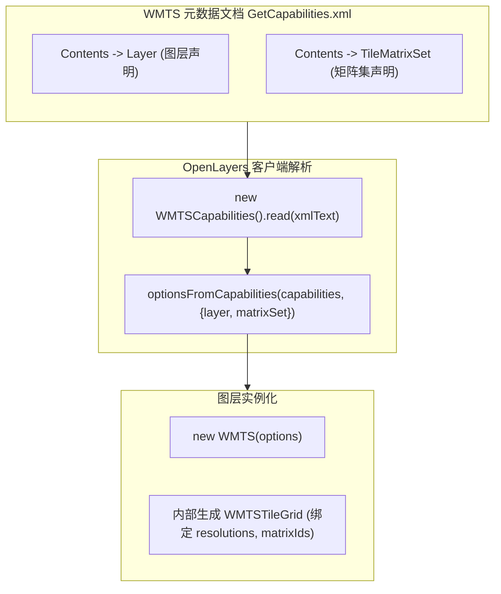

<nav aria-label="breadcrumb"><ol class="breadcrumb mb-4"><li class="breadcrumb-item"><a href="../">Home</a></li><li class="breadcrumb-item"><a href="./">Summary</a></li><li class="breadcrumb-item active" aria-current="page">WMTS 瓦片地图服务指南</li></ol></nav>

# OpenLayers WMTS 瓦片地图服务与时空多维切片全景实战指南

> 在开放地理空间信息联盟（OGC）标准体系中，**WMTS（Web Map Tile Service，OGC 07-057r7）** 是工业级预渲染栅格与矢量瓦片分发的核心标准。与动态实时计算渲染的 WMS 相比，WMTS 采用标准分层金字塔模型（TileMatrixSet），支持高并发缓存加速。
>
> OpenLayers 原生深度集成了 WMTS 规范，不仅支持手工配置复杂的瓦片矩阵金字塔，还提供了强大的 **`optionsFromCapabilities`** 自动元数据解析引擎，并支持多维时空切片（Dimensions）与跨国权威机构（如法国国家地理 IGN）投影金字塔对接。本文基于 4 个核心官方示例，系统解构 WMTS 架构模型、元数据解析机制与多维切片调度。

---

## 1. 架构总览：4 个 WMTS 核心官方示例矩阵

| 分类                 | 示例标识                                                                                  | 核心机制 / 关键 API                                      | 解决的典型生产场景                               |
| :------------------- | :---------------------------------------------------------------------------------------- | :------------------------------------------------------- | :----------------------------------------------- |
| **元数据自动解析**   | [`wmts-capabilities`](../en/latest/examples/wmts-capabilities.html)                       | `ol/format/WMTSCapabilities` + `optionsFromCapabilities` | 解析 XML 元数据，提取图层列表与矩阵集参数        |
| **全自动图层构建**   | [`wmts-layer-from-capabilities`](../en/latest/examples/wmts-layer-from-capabilities.html) | `optionsFromCapabilities` 一键生成 `TileLayer`           | 零手动配置切片金字塔，自动化接入第三方 WMTS 服务 |
| **时空多维切片过滤** | [`wmts-dimensions`](../en/latest/examples/wmts-dimensions.html)                           | `source.updateDimensions()` + 瓦片加载过渡（Transition） | 气象时序雷达、历史遥感影像多时间轴平滑回放       |
| **权威测绘机构对接** | [`wmts-ign`](../en/latest/examples/wmts-ign.html)                                         | IGN Geoportail 官方矩阵集 + 分辨率与原点对齐             | 接入国家级基础测绘底图，解决自定义切片原点偏位   |

---

## 2. WMTS 核心规范与切片金字塔数学模型

### 2.1 TileMatrixSet 瓦片矩阵集构成

在 OGC WMTS 规范中，切片系统由三级逻辑实体构成：

1. **Layer**：业务图层单元，包含 Style（样式标识）与 Format（图像格式，如 `image/png`、`image/jpeg`）；
2. **TileMatrixSet**：瓦片矩阵集合，绑定特定的空间参考系（CRS，如 `EPSG:3857` 或 `EPSG:4326`）；
3. **TileMatrix**：每个缩放层级（Zoom Level）的具体矩阵定义，关键属性包括：
   - `Identifier`：层级标识（如 `"0"`, `"1"` 或 `"EPSG:3857:0"`）；
   - `ScaleDenominator`：标准比例尺分母；
   - `TopLeftCorner`：切片网格左上角坐标原点 $[x_0, y_0]$；
   - `TileWidth` / `TileHeight`：单个切片像素尺寸（通常为 256 或 512）；
   - `MatrixWidth` / `MatrixHeight`：该层级切片网格的列数与行数。



### 2.2 比例尺分母与地面分辨率转换数学公式

OGC WMTS 规范将标准显示器像元尺寸定义为 **$0.28\text{ mm} = 0.00028\text{ m}$**（对应约 90.71 DPI）。
分辨率 $R$（单位：米/像素）与比例尺分母 $S_D$（ScaleDenominator）之间的换算公式为：

$$R = S_D \times 0.00028$$

反之，若已知目标层级的米制分辨率 $R$，其对应的 OGC 比例尺分母为：

$$S_D = \frac{R}{0.00028} \approx R \times 3571.42857$$

---

## 3. 元数据解析实战：从 GetCapabilities 到图层直显

手动书写 20 个层级的 `resolutions` 与 `matrixIds` 极易因浮点数舍入误差导致切片错位或 404 错误。OpenLayers 提供了两步自动化方案：

### 3.1 核心解析范式（`wmts-layer-from-capabilities`）

```javascript
import WMTS, { optionsFromCapabilities } from "ol/source/WMTS";
import WMTSCapabilities from "ol/format/WMTSCapabilities";
import TileLayer from "ol/layer/Tile";

const parser = new WMTSCapabilities();

fetch("https://server.com/wmts?service=WMTS&request=GetCapabilities")
  .then((response) => response.text())
  .then((text) => {
    // 1. 将 XML 解析为结构化 JavaScript 对象
    const result = parser.read(text);

    // 2. 提取指定图层与矩阵集的完整切片配置
    const options = optionsFromCapabilities(result, {
      layer: "layer-id",
      matrixSet: "EPSG:3857",
      format: "image/png",
      style: "default",
    });

    // 3. 构建 WMTS 数据源与图层
    const wmtsLayer = new TileLayer({
      opacity: 1,
      source: new WMTS(options),
    });

    map.addLayer(wmtsLayer);
  });
```

---

## 4. 时空多维切片过滤：动态 Dimensions 与平滑过渡

气象预报、卫星遥感等高频动态数据通常按时间戳分块生成 WMTS 切片。

### 4.1 动态维度更新机制（`wmts-dimensions`）

在 `ol/source/WMTS` 中，维度参数通过 `dimensions` 字典管理：

```javascript
const wmtsSource = new WMTS({
  // ...基础切片配置
  dimensions: {
    Time: "2026-10-15T00:00:00Z",
    Elevation: "500",
  },
});

// 当用户拖动时间轴滑块时：
function updateTime(newTimeIsoString) {
  // 1. 动态更新维度参数
  wmtsSource.updateDimensions({ Time: newTimeIsoString });
  // 2. OpenLayers 内部会自动更新后续切片请求的 URL 模板参数
}
```

### 4.2 避免时间轴切换闪烁：过渡动效（Tile Transitions）

快速切换时间戳时，若直接清空旧切片会导致地图短暂白屏。
OpenLayers 通过切片过渡动画机制解决这一问题：

- 在 `ol/layer/Tile` 中配置 `transition: 250`（毫秒）；
- 新时间切片在后台下载解码完成前，旧切片保持显示；当新切片就绪后，通过 Alpha 透明度渐变交叉淡入，保证视觉连续性。

---

## 5. 跨国权威测绘机构切片对接避坑（以法国 IGN 为例）

示例 [`wmts-ign`](../en/latest/examples/wmts-ign.html) 展现了对接国家级测绘系统时的关键技术点：

1. **投影原点定义**：部分欧洲测绘机构的切片网格原点设置在极西北方向（如 $[-20037508, 20037508]$ 甚至更大包围盒），切勿默认使用赤道或局部范围原点；
2. **切片矩阵标识格式**：IGN 等服务商的 `matrixIds` 往往采用特定前缀格式（如 `"PM:0"`, `"PM:1"`），必须与能力文档完全一致；
3. **鉴权 Key 参数注入**：许多商业与政府 WMTS 服务采用 URL 路径参数注入 API Key（如 `https://data.geopf.fr/wmts?apikey=...`），在构建请求模板时需统一携带。

---

## 附录：4 个官方 WMTS 核心示例直达索引

1. [`wmts-capabilities`](../en/latest/examples/wmts-capabilities.html) &mdash; 解析 WMTS 元数据能力文档并提取图层矩阵集
2. [`wmts-layer-from-capabilities`](../en/latest/examples/wmts-layer-from-capabilities.html) &mdash; 从 GetCapabilities 自动构建 WMTSLayer 实例
3. [`wmts-dimensions`](../en/latest/examples/wmts-dimensions.html) &mdash; WMTS 多维时空切片切换与无缝过渡动效
4. [`wmts-ign`](../en/latest/examples/wmts-ign.html) &mdash; 法国国家地理 IGN 官方 WMTS 底图服务高精度对接
