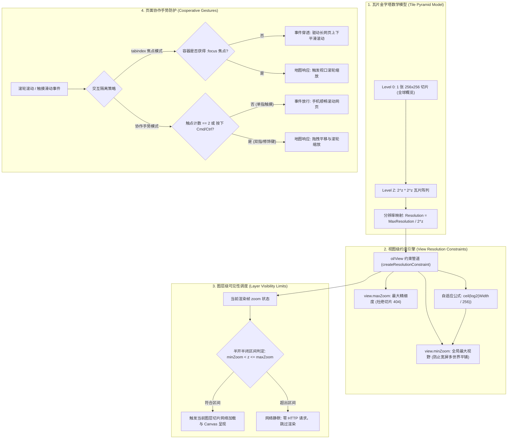
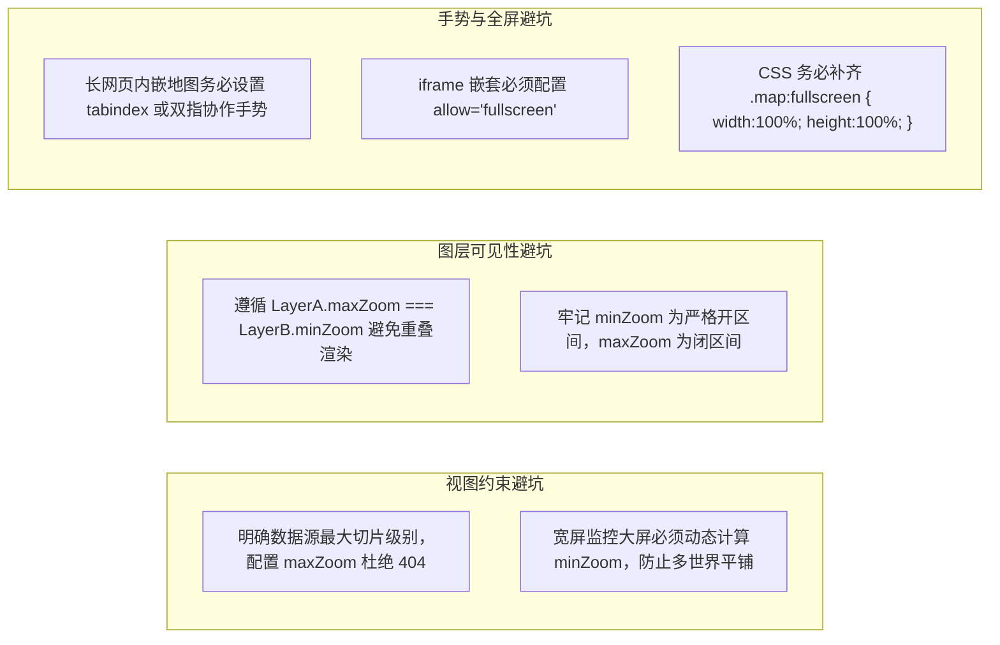

# OpenLayers 视口缩放控制与多尺度交互架构全景指南 (Zoom Control & Multi-Scale Interaction Architecture)

> 本指南基于 OpenLayers 官方 **zoom** 核心专题群的代表性示例，深度解构 WebGIS 视口分辨率数学模型、视图级与图层级双重可见性区间约束、长页面嵌入时的“滚轮缩放陷阱（Scroll Trap）”协同防御机制、移动端双指与桌面修饰键协作手势（Cooperative Gestures），以及沉浸式全屏与复合旋转缩放动力学交互的最佳工程实践。

---

## 一、视口缩放与多尺度金字塔全景架构 (Architectural Overview)

在 WebGIS 中，缩放并非简单的图像拉伸，而是涉及空间地理坐标、切片分辨率等级与渲染视口的复杂数学映射：



---

## 二、视图级缩放约束与单世界自适应解算 (`View Constraints`)

### 1. 宽屏显示器下的多世界平铺（World Wrapping）缺陷
在标准的 Web 墨卡托（EPSG:3857）金字塔模型中，$z=0$ 时全球被投影为一个 $256 \times 256$ 像素的正方形。随着高分宽屏显示器（如 1920px、2560px 甚至 4K）的普及，若地图容器宽度 $W > 256$ 且允许缩放至 $z=0$，屏幕横向会同时重复平铺 8~15 个重复拼接的世界地图，导致严重的视觉割裂与交互失焦。

### 2. 对数临界阈值推导
要确保屏幕横向刚好**仅完整容纳单个世界地图**，必须满足当前层级切片总宽度大于等于容器宽度：
$$256 \times 2^z \ge W \implies 2^z \ge \frac{W}{256} \implies z \ge \log_2\left(\frac{W}{256}\right)$$

利用自然对数换底公式与 JavaScript 常量 `Math.LOG2E`（即 $\log_2(e) \approx 1.442695$）：
$$z_{\min} = \left\lceil \log_2(e) \cdot \ln\left(\frac{W}{256}\right) \right\rceil$$

在 [`examples/min-zoom.html`](file:///d:/Users/Downloads/openlayers/examples/min-zoom.html) 中，该算法被优雅地封装并在窗口尺寸变动时动态更新：

```javascript
function getMinZoom() {
  const width = viewport.clientWidth;
  return Math.ceil(Math.LOG2E * Math.log(width / 256));
}

// 监听窗口尺寸变化，动态修正最小限制
window.addEventListener('resize', function () {
  const minZoom = getMinZoom();
  if (minZoom !== view.getMinZoom()) {
    view.setMinZoom(minZoom);
  }
});
```

### 3. 静态级别硬约束 (`minZoom` 与 `maxZoom`)
在 [`examples/zoom-constrained.html`](file:///d:/Users/Downloads/openlayers/examples/zoom-constrained.html) 中，当数据源仅覆盖特定分辨率（如局部航测正射影像或特定区域矢量切片）时，可在创建 `View` 时显式声明级别边界：
```javascript
const view = new View({
  center: [-13553864, 5918250],
  zoom: 11,
  minZoom: 9,   // 钳制最小级别：禁止缩放到无意义的全球宏观概览
  maxZoom: 13,  // 钳制最大级别：杜绝超出切片深度的无效 404 请求
});
```

---

## 三、多尺度图层可见性与无缝切换架构 (`Layer Zoom Limits`)

在数字制图（Digital Cartography）中，宏观大视野需呈现简洁平整的综合行政区划底图，而进入微观街区后需渐进切换为高精度卫星影像、航测等高线或建筑白模。

### 1. 半开半闭可见性数学区间
在 OpenLayers 中，图层上的 `minZoom` 与 `maxZoom` 具有极其严密的数学区间定义：
$$\text{Layer is Visible} \iff \text{minZoom} < z \le \text{maxZoom}$$

> [!IMPORTANT]
> **关键边界原则**：`minZoom` 为**严格大于（开区间）**，`maxZoom` 为**小于等于（闭区间）**。

以 [`examples/layer-zoom-limits.html`](file:///d:/Users/Downloads/openlayers/examples/layer-zoom-limits.html) 为例：
- **基础 OSM 概览图层**：配置 `maxZoom: 14`，当 $z \le 14$ 时可见；
- **精细 Outdoor 地形图层**：配置 `minZoom: 14`，当 $z > 14$ 时可见；
在临界点 $z=14.0$ 时，仅有 OSM 图层参与渲染。

```javascript
const map = new Map({
  layers: [
    new TileLayer({
      maxZoom: 14, // 14 级及以下显示（zoom <= 14）
      source: new OSM(),
    }),
    new TileLayer({
      minZoom: 14, // 超过 14 级显示（zoom > 14）
      source: new TileJSON({
        url: 'https://api.maptiler.com/maps/outdoor-v2/tiles.json?key=' + key,
        tileSize: 512,
      }),
    }),
  ],
  view: new View({ center: centerCoords, zoom: 15, maxZoom: 18 }),
});
```

### 2. 图层未激活时的网络静默（Network Silence）
当视口缩放级别超出图层设定的 `(minZoom, maxZoom]` 区间时，OpenLayers 切片渲染调度器（TileQueue）会**直接阻断该图层的切片加载**。即使后台配置了数百万张瓦片，未处于可见区间的图层也不会产生任何 HTTP 网络开销与内存占用。

---

## 四、长网页“滚轮缩放陷阱”与协作手势防御机制

当 OpenLayers 地图被嵌入在包含丰富文字、产品展示或新闻资讯的长滚动网页中时，用户快速滚动鼠标滚轮极易被地图拦截，造成“页面突然卡住、地图疯狂缩放”的极差体验（业界称之为 **Scroll Trap**）。

### 1. 方案一：`tabindex` 焦点优先隔离模式
[`examples/page-scroll.html`](file:///d:/Users/Downloads/openlayers/examples/page-scroll.html) 展示了纯 HTML 属性驱动的焦点隔离方案：
```html
<!-- 为地图 div 挂载 tabindex 属性赋予其键盘和鼠标焦点能力 -->
<div tabindex="1" id="map" class="map"></div>
```
- **工作机制**：当用户滚轮滑动经过地图上方时，若地图容器尚未被用户明确点击对焦（未处于 `:focus` 状态），`MouseWheelZoom` 交互会**主动放弃捕获该事件**，事件顺畅冒泡至浏览器窗口，长网页丝滑滚动；
- **进入缩放**：仅当用户鼠标点击地图内部使其获得焦点后，滚轮事件才会被转为地图缩放指令。

### 2. 方案二：移动端双指与桌面修饰键协作手势（Cooperative Gestures）
[`examples/two-finger-pan-scroll.html`](file:///d:/Users/Downloads/openlayers/examples/two-finger-pan-scroll.html) 展现了与 Google Maps / Apple Maps 体验完全一致的现代手势规范：

```javascript
const map = new Map({
  interactions: defaults({
    dragPan: false,        // 卸载默认的单指平移
    mouseWheelZoom: false, // 卸载默认的无条件滚轮缩放
  }).extend([
    // 1. 触控屏双指拖动，或桌面端按住 Cmd/Ctrl 键拖动
    new DragPan({
      condition: function (event) {
        return this.getPointerCount() === 2 || platformModifierKeyOnly(event);
      },
    }),
    // 2. 桌面端按住 Cmd/Ctrl 键才允许滚轮缩放
    new MouseWheelZoom({
      condition: platformModifierKeyOnly,
    }),
  ]),
});
```
- **移动端绝佳体验**：用户在手机浏览器上单指滑动屏幕时，无论是滑过文本还是滑过地图，整个网页均能一气呵成地上下滑动；只有使用**双指捏合或双指滑动**时，地图才响应平移与缩放。
- **跨平台修饰键**：`platformModifierKeyOnly` 自动在 macOS 上映射为 `Command` 键，在 Windows/Linux 上映射为 `Ctrl` 键，免去手动维护平台判断分支。

---

## 五、沉浸式全屏与复合动力学手势 (`FullScreen & DragRotateAndZoom`)

在指挥中心大屏、应急指挥车与遥感解译工作站中，全屏沉浸与连续三维手势变换是标配交互：

[`examples/full-screen-drag-rotate-and-zoom.html`](file:///d:/Users/Downloads/openlayers/examples/full-screen-drag-rotate-and-zoom.html) 演示了全屏控件与复合拖拽手势的融合：

```javascript
const map = new Map({
  controls: defaultControls().extend([new FullScreen()]),
  interactions: defaultInteractions().extend([new DragRotateAndZoom()]),
  target: 'map',
  view: new View({
    center: [-33519607, 5616436],
    rotation: -Math.PI / 8,
    zoom: 8,
  }),
});
```

### 1. `DragRotateAndZoom` 极坐标复合动力学
用户按住 `Shift + 鼠标左键拖拽` 时：
1. 交互以拖拽起点为基准，实时解算鼠标当前位置相对于视口中心的夹角变化量 $\Delta \theta$；
2. 实时比对径向半径变化量 $\Delta r$，按对数比例动态映射缩放值 $\Delta z = \log_2(r_1 / r_0)$；
3. 一次拖拽动作即可**同时实现平滑无级旋转与连续缩放**，极大提升遥感影像的航向对齐效率。

### 2. 全屏 CSS 尺寸铺满红线
使用 `FullScreen` 控件时，必须确保地图容器在全屏伪类下拥有 100% 宽高：
```css
.map:fullscreen {
  width: 100%;
  height: 100%;
}
```

---

## 六、缩放控制与多尺度交互核心示例矩阵 (Examples Matrix)

| 示例文件与链接 | 技术切入点 | 核心 API / 关键配置 | 典型业务落地场景 |
| :--- | :--- | :--- | :--- |
| [`examples/min-zoom.html`](file:///d:/Users/Downloads/openlayers/examples/min-zoom.html) | 动态全局视野约束 | `view.setMinZoom()`, `Math.LOG2E` 自适应公式 | 宽屏显示器、大屏指挥系统消除横向多世界平铺 |
| [`examples/zoom-constrained.html`](file:///d:/Users/Downloads/openlayers/examples/zoom-constrained.html) | 静态层级区间钳制 | `View({ minZoom: 9, maxZoom: 13 })` | 局部航测正射项目、保护底图防止超量请求 404 |
| [`examples/layer-zoom-limits.html`](file:///d:/Users/Downloads/openlayers/examples/layer-zoom-limits.html) | 多尺度图层动态调度 | `Layer({ minZoom: 14, maxZoom: 14 })` (开闭区间) | 宏观概览与微观高清地形/卫星图无缝自动切换 |
| [`examples/page-scroll.html`](file:///d:/Users/Downloads/openlayers/examples/page-scroll.html) | 滚轮焦点隔离模式 | `<div tabindex="1" id="map">` | 博客文章、新闻专栏、落地页防止滚轮陷入缩放 |
| [`examples/two-finger-pan-scroll.html`](file:///d:/Users/Downloads/openlayers/examples/two-finger-pan-scroll.html) | 移动端协作手势 | `DragPan({ condition: 2_fingers || modifierKey })` | 移动端网页内嵌地图标准协作手势（避免滚动卡死） |
| [`examples/full-screen-drag-rotate-and-zoom.html`](file:///d:/Users/Downloads/openlayers/examples/full-screen-drag-rotate-and-zoom.html) | 全屏与复合旋转缩放 | `FullScreen`, `DragRotateAndZoom` (Shift+拖拽) | 沉浸式全屏地图、遥感影像多角度飞行对齐查看 |
| [`examples/pinch-zoom.html`](file:///d:/Users/Downloads/openlayers/examples/pinch-zoom.html) | 移动端捏合缩放 | `ol/interaction/PinchZoom` | 智能手机与平板触控屏双指平滑无级缩放 |
| [`examples/zoomslider.html`](file:///d:/Users/Downloads/openlayers/examples/zoomslider.html) | 缩放滑块 UI 定制 | `ol/control/ZoomSlider`, 纯 CSS 定制滑轨与游标 | 桌面端大屏缩放层级直观滑动选择与刻度呈现 |
| [`examples/drag-rotate-and-zoom.html`](file:///d:/Users/Downloads/openlayers/examples/drag-rotate-and-zoom.html) | 复合手势基础应用 | `DragRotateAndZoom` | 桌面端高自由度地图视角探索与复合变换 |
| [`examples/double-click-drag-zoom.html`](file:///d:/Users/Downloads/openlayers/examples/double-click-drag-zoom.html) | 单手双击拖拽缩放 | `DoubleClickDragZoom` | 移动端与单手鼠标操作时的快速推拉视口缩放 |

---

## 七、生产级工程避坑指南 (Production Pitfalls Checklist)



1. **图层边界层级重叠导致的性能裂化（Z-fighting）**：
   在配置多级图层切换时，切忌将低级图层设为 `maxZoom: 15`，同时将高级图层设为 `minZoom: 14`。这会导致在 14~15 级之间两个图层同时可见，并发发起两倍的切片网络请求，并在 Canvas 上进行双重像素混合。必须保证 `LayerA.maxZoom === LayerB.minZoom`。
2. **iframe 全屏权限丢失**：
   在现代前端微前端或门户架构中，地图常作为子应用运行在 `<iframe>` 内。若父容器未给 iframe 标签添加 `allow="fullscreen"` 或 `allowfullscreen="true"` 属性，`FullScreen` 控件会被浏览器静默禁用并自动隐藏，排查时极易被误判为代码逻辑 bug。
3. **触控协作模式下的提示覆盖层**：
   当启用了 `two-finger-pan-scroll` 协作模式后，在移动端如果用户习惯性地使用单指拖拽地图，地图会静止不动而页面跟随滚动。为了提供极致的用户体验，建议在地图视口上方悬挂一个透明提示蒙版，监听地图的 `pointerdown` 事件：当检测到单指触摸且持续拖动时，渐变显示“请使用双指移动地图”半透明提示并在 1.5 秒后淡出。
